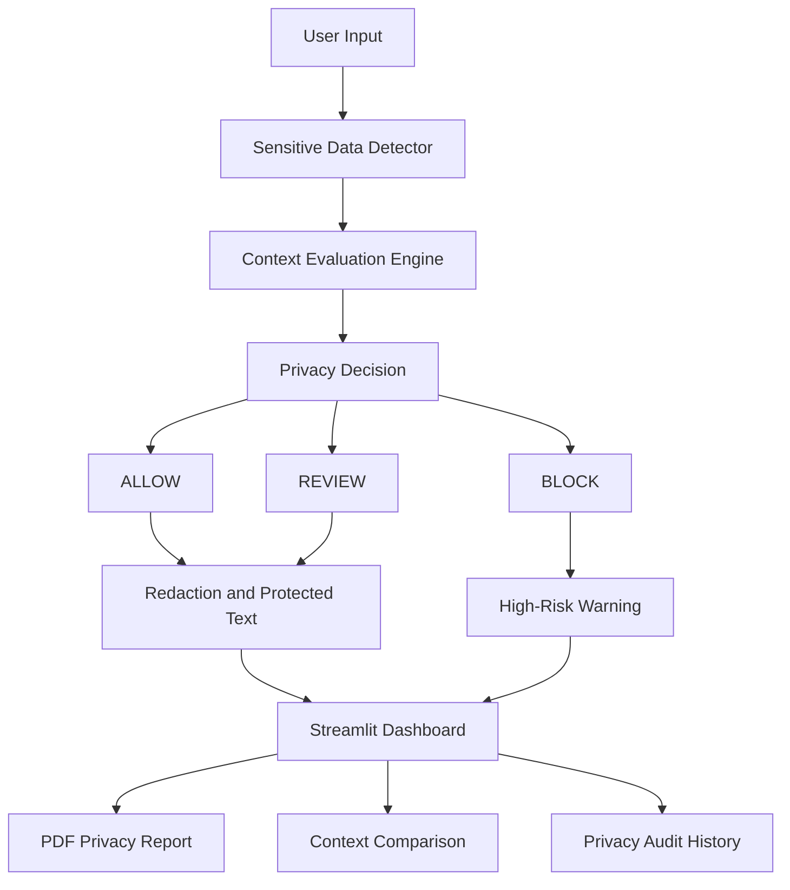

# 🔐 ContextAware AI — Smart Data Privacy Guardian

> Your data, your choice. Let's keep your digital world safe!

ContextAware AI is a Python-based privacy protection prototype that detects
potentially sensitive information, evaluates sharing risks based on context,
and helps protect personal information through redaction.

The project demonstrates how privacy decisions can depend on both the type
of data being shared and the intended recipient or purpose.

## 🎯 Problem Statement

People frequently share information online without realizing that messages
may contain personal or sensitive data.

The same information may be acceptable in one context but risky in another.
For example, sharing an email address internally may be acceptable, while
sharing it publicly may create privacy risks.

## 💡 Our Solution

ContextAware AI combines three main components:

1. **Sensitive Data Detection** — identifies supported patterns such as
   email addresses, Indian mobile numbers, Aadhaar-like numbers,
   payment-card-like numbers, and selected medical information.

2. **Context-Aware Evaluation** — evaluates detected information using
   configurable rules based on the recipient and purpose.

3. **Data Redaction** — replaces supported sensitive patterns and selected
   medical sentences with redaction labels before the text is shared.

The dashboard displays findings, risk levels, privacy decisions,
explanations, a context comparison, and a downloadable PDF report.

## ✨ Features

- Sensitive information detection
- Context-based privacy evaluation
- ALLOW, REVIEW, and BLOCK decisions
- Risk-level indicators
- Automatic redaction of supported information
- Comparison of privacy decisions for different recipients
- Interactive Streamlit dashboard
- Downloadable PDF privacy report
- Session-based privacy audit history
- Automated unit tests

## 🛠️ Technologies Used

- Python
- Streamlit
- Regular Expressions (Regex)
- Pandas
- Matplotlib
- ReportLab
- Python unittest

## 🏗️ System Architecture

## 📁 Project Structure

ContextAwareAI/
├── app.py
├── detector.py
├── context_engine.py
├── redactor.py
├── test_privacy.py
└── README.md

## 🚀 Getting Started

### 1. Clone the repository

```bash
git clone https://github.com/AnupamaKambar/ContextAwareAI.git
cd ContextAwareAI